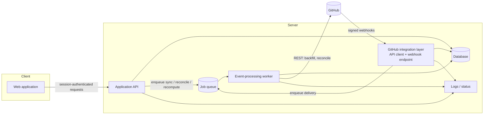
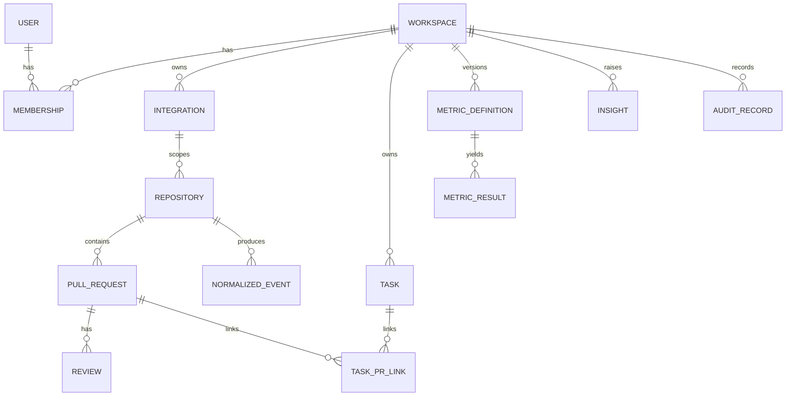

# DevFlow — Technical Architecture

| Field | Value |
|---|---|
| Status | Draft v0.1. Entirely **PROPOSED**; no implementation exists to verify. |
| Source | `mvp.md` §9, §12, §13, §16 (architecture *direction*, explicitly "not a locked technology decision"). |
| Related | [prd.md](prd.md) · [design.md](design.md) · [rules.md](rules.md) · [memory.md](memory.md) · [security.md](security.md) · [phases.md](phases.md) |

## 1. Current implementation status

| Item | Status |
|---|---|
| Repository inspected | **No repository was provided.** Language, framework, database, auth, styling, build tooling, tests: **unknown** (not VERIFIED). |
| Implemented features | None can be claimed. |
| Existing docs | Only `mvp.md`. |

Action when a repository appears: inspect manifests, config, schema, routes, components, tests; replace the "Unknown" cells in §2 with VERIFIED entries and repo paths; reconcile this document.

## 2. Technology stack

`mvp.md` §16.1 lists a *possible* stack ("a suitable option, not a requirement"). It is recorded below as candidates, not decisions.

| Layer | Candidates named in `mvp.md` | Decision | Criteria to decide (PROPOSED) |
|---|---|---|---|
| Frontend | Next.js or React with TypeScript | OPEN (OQ-11) | Team skill; SSR need (none stated) |
| Styling | Tailwind CSS or a consistent component system | OPEN | Must be able to express tokens in [design.md](design.md) §4 |
| Charts | Recharts or similar | OPEN | Must support accessible text alternatives; see design.md §9 |
| Backend | Node.js with Express or NestJS | OPEN | Type sharing with frontend; job-worker support |
| Database | PostgreSQL ("worth considering") or MongoDB | OPEN | Needs unique constraints for idempotency, relational links, transactional audit writes, workspace scoping; choose after validating query patterns (§9 of this doc) |
| Jobs | BullMQ + Redis, or managed job system "if needed" | OPEN | Needed for resumable sync, retries with backoff, recomputation |
| Hosting | Any platform with secure env vars, webhook endpoints, background jobs, durable DB | OPEN | — |
| Auth | "Secure sign-in mechanism appropriate to the selected implementation" | OPEN | OAuth via GitHub login is **not** assumed; sign-in and GitHub App installation are distinct concerns (§7) |

## 3. Proposed system architecture

Components follow `mvp.md` §16 items 1–7. No additional services are introduced.

Whether the queue is a separate technology or a database-backed job table is OPEN (OQ-11); the diagram shows the logical role only. The worker may run in the same deployable as the API if scale permits (`mvp.md` §16: "if required by the chosen scale").

## 4. Modules and responsibilities

| Module | Responsibility | Requirements |
|---|---|---|
| Web application | Overview, Tasks, Bottlenecks, lifecycle explorer, Integrations & Data Quality, Settings (see [design.md](design.md)). Never holds credentials. | FR-060–FR-072, FR-090, FR-110–FR-113, FR-016 |
| Application API | Authentication, workspace access checks, queries, settings, link management, insight status changes, enqueueing sync/reconcile jobs | FR-001–FR-004, FR-040–FR-046, FR-082, FR-100–FR-103, NFR-001 |
| GitHub integration layer | Authorization/installation handling, API client with pagination and rate-limit handling, repository sync, webhook endpoint (signature check, persist, enqueue, acknowledge) | FR-010–FR-019, FR-020–FR-022 |
| Event-processing worker | Normalization, idempotency, retries, reconciliation, metric recomputation, rule evaluation, insight upsert | FR-024–FR-030, FR-050–FR-056, FR-080–FR-083 |
| Metric engine (worker library) | Pure functions: normalized events + definition version → result. No UI, network or clock dependencies except an explicit evaluation timestamp. | FR-050–FR-058, NFR-003 |
| Rules engine (worker library) | Evaluate versioned rules against events/metric inputs with explicit evaluation time; return evidence | FR-080, FR-081 |
| Database | System of record for all entities in §9 | all |
| Job queue | Asynchronous sync, reconciliation, recomputation, retries | FR-022, FR-028 |
| Observability | Structured logs, processing errors, sync status, basic operational alerts | NFR-009, FR-029 |

Rationale for isolating the metric and rules engines as pure functions: `mvp.md` requires determinism and reproducible recomputation (§5 principle 6, NFR-003); pure functions are directly testable against ground-truth fixtures.

## 5. Data flow

### 5.1 Connect and historical sync (`mvp.md` §8.1, §16.2) — PROPOSED order

1. User signs in; workspace exists.
2. User starts GitHub authorization; API stores installation/account identifiers (no tokens exposed to browser).
3. User selects repositories; Integration and Repository rows are created (`Connecting`).
4. **Register/verify webhooks first**, then start a resumable backfill job, so no events fall in a gap between import and live delivery (`mvp.md` §16.2 suggests this approach; overlap is reconciled by idempotency). Status → `Syncing`.
5. Worker pages through PRs/reviews, upserts source records and normalized events idempotently, persisting a checkpoint after each page.
6. On completion the sync is marked complete; only then may the UI say fully synced (BR-09). Partial results are labelled partial.

### 5.2 Webhook delivery

1. Receive request → verify signature over the raw body using GitHub's documented method **before parsing** (FR-020).
2. Persist raw delivery + delivery ID with `received_at`; reject if signature invalid (nothing stored beyond a security log entry without payload).
3. Enqueue processing; return success promptly (FR-022). A success response does not imply processing completed.
4. Worker normalizes to the internal event model (FR-024), computes `deduplication_key`, inserts under a unique constraint (FR-021, FR-026).
5. Worker recomputes affected metric results and re-evaluates rules for affected PRs (FR-030).
6. Failure: bounded exponential backoff; after exhaustion record `processing_status` failed with error and surface on Data Quality (FR-028, FR-029).

### 5.3 Reconciliation (`mvp.md` §16.3)

Fetch source state for a defined window/scope → compare with stored state → upsert corrected source records and normalized events → recompute affected results → record reconciliation time and outcome → safe to rerun (no duplicated effects). Differences are recorded, not hidden (BR-11).

### 5.4 Link change

User action → authorization check → write relationship + audit record in one transaction → enqueue recompute of affected task-linked metrics → UI reflects new calculation (`mvp.md` §8.4).

## 6. API contracts and integration boundaries

**Known (REQUIREMENT):** the browser talks only to the Application API; the browser never receives GitHub tokens or webhook secrets; the webhook endpoint accepts GitHub deliveries only after signature validation; all API reads/writes enforce workspace access.

**Not known:** route paths, payload shapes, status codes, pagination style of DevFlow's own API, and authentication transport (cookie vs token). No endpoint is defined here. **OPEN** until the stack is chosen (OQ-11).

Capability groups the API must expose (derived from FR IDs, not endpoint definitions):

| Group | Needed by |
|---|---|
| Session/account | FR-001 |
| Workspace and membership | FR-002–FR-004 |
| Integration lifecycle (start authorization, list repos, select scope, status, disconnect) | FR-010–FR-013, FR-110, FR-113 |
| Metric results and contributing records | FR-060, FR-061 |
| Lifecycle timeline for a PR/task | FR-070, FR-071 |
| Task–PR links (list, confirm, change, remove) + audit | FR-040–FR-046 |
| Insights (list, detail, acknowledge, resolve, note) | FR-080–FR-083, FR-100–FR-103 |
| Data-quality status and error detail | FR-090, FR-091 |
| Settings (thresholds, window, key format, bots, timezone) + audit | FR-111, FR-115–FR-117 |
| Metric definitions (read) | FR-112 |
| Retention/deletion request | FR-114 |
| Admin reconcile/replay (if built) | FR-133 |

External contracts to verify against **current** GitHub documentation at implementation time (links in `mvp.md` §23; not re-fetched here): PR and review REST endpoints, webhook event names and payload fields, webhook signature scheme, GitHub App permission names, rate-limit behaviour. The normalized event model must not depend on one webhook payload shape (FR-024).

## 7. Authentication and authorization architecture

| Concern | Position |
|---|---|
| Sign-in mechanism | OPEN (OQ-11). Must support sign-out and account management (FR-001). |
| Workspace isolation | PROPOSED AD-05: every workspace-owned row carries `workspace_id`; every query and mutation takes the workspace from the authenticated session, never from a client-supplied value alone; isolation is tested (NFR-001). |
| Roles | OPEN (OQ-12). Authorization check is a single server-side function receiving (user, workspace, action) so owner-only vs owner/member is a policy change, not a refactor. |
| GitHub authorization | GitHub App or equally scoped model (FR-010). Installation tokens are server-side, short-lived by GitHub's design (verify in docs), never sent to the browser. |
| Webhook trust | Signature validation only; webhook requests carry no user session. |

## 8. Error handling, logging, observability

- Webhook endpoint: invalid signature → reject, log event type and delivery ID only (no payload, no secrets). Valid but unprocessable payload → store, mark failed, surface on Data Quality.
- Worker: transient errors retried with bounded exponential backoff; permanent errors recorded with `processing_error` (FR-028, FR-029).
- GitHub API 403/429 rate-limit responses: back off, resume from checkpoint, expose in sync health (FR-014, FR-015).
- Revoked installation: stop calls, status `Needs attention`, keep existing data per retention policy (BR-09).
- Logs are structured; they must never contain tokens, webhook secrets or sensitive payload fragments (NFR-005; see [security.md](security.md) §9).
- Operational signals required: sync state per integration, failed-processing count, retry status, last successful sync/reconciliation (NFR-009). Alerting channel for operators: OPEN.

## 9. Data model (conceptual; `mvp.md` §12 — not a final schema)

`MEMBERSHIP` appears only if OQ-12 resolves to a role model (FR-003). `TASK` and its fields depend on OQ-01; `mvp.md` §9.4 requires distinguishing an issue from a PR if GitHub Issues are used.

| Entity | Key fields (from `mvp.md` §12; refine in technical design) |
|---|---|
| Workspace, User | ID, name/display name, timestamps, settings / auth identity, status |
| Integration | workspace ID, provider, external installation/account ID, permissions metadata, status, connected, last sync, last reconciliation, error summary. **Secrets stored separately and never returned by APIs or logs.** |
| Repository | internal ID, integration ID, stable external repo ID, owner/name (display only), status, last sync |
| Task | internal ID, workspace ID, source type/ID, key, title, state, created/updated/started/completed **only when genuinely available**, URL |
| Pull request | internal ID, repository ID, stable external ID/number, title, URL, author identifier, draft status, created/ready/closed/merged timestamps, state, latest source update |
| Review | stable source ID, PR ID, reviewer reference, state, submitted/dismissed timestamps, bot classification status |
| Normalized event | `id, workspace_id, integration_id, repository_id, source, source_event_type, source_delivery_id, subject_type, subject_id, action, occurred_at, received_at, source_updated_at, payload_version, raw_payload_reference, processing_status, processing_error, deduplication_key` (`mvp.md` §9.3 suggested fields) |
| Task–PR link | workspace ID, task source/ID/key, repository ID, PR ID, matching_method, match_status, created/updated, created_by, confirmed_by/at, audit_reason |
| Metric definition | ID/name, version, start/end rules, inclusion/exclusion, unit, elapsed/working mode, cohort, status behaviour |
| Metric result | value or state, definition version, cohort/window, sample count, coverage status, calculated_at, supporting event refs |
| Insight | rule ID/version, scope, threshold, observed value, affected refs, evidence, status, timestamps, status history |
| Audit record | actor (user or system), action, subject, before/after or reason, timestamp |

Modelling rules: identities are stable source IDs, never display names (BR-13); timestamps UTC (NFR-004); idempotency through a unique constraint on `(workspace_id, deduplication_key)` or equivalent (PROPOSED AD-02).

## 10. Configuration and environment management

| Concern | Position |
|---|---|
| Secrets (GitHub App private key, webhook secret, DB credentials, session secret) | Server-side secret store or encrypted configuration; never in repository, client bundle, API response or log (NFR-005). |
| Environment variable catalogue | Not defined (no repository). Create an example file listing names only, never values, when the stack is chosen. |
| Per-workspace settings | Date window, thresholds, task-key format, bot exclusion, timezone/working calendar (FR-111, FR-115–FR-117); changes are audited (FR-120). |
| Environments | OPEN. At minimum a local/test environment using fixtures and a test GitHub installation (`mvp.md` §18.4). |

## 11. Deployment and scaling considerations

Scale targets are not stated in `mvp.md`; none are invented. Design constraints that are stated: the webhook endpoint must respond promptly while heavy work is asynchronous; long syncs must be resumable; GitHub rate limits require bounded concurrency; recomputation must be incremental to affected records where possible (FR-030). Whether API, webhook endpoint and worker are one or several deployables is OPEN (OQ-11) and should follow measured load from the pilot.

## 12. Architectural decisions

| ID | Decision | Status | Rationale / source |
|---|---|---|---|
| AD-01 | MVP task source (Path A / B / C) | **OPEN (OQ-01)** | `mvp.md` §9.4; shapes Task entity, Tasks screen, MET-03 |
| AD-02 | Store raw event + normalized event; compute metrics from normalized events; dedupe by key under unique constraint | PROPOSED | §5 principles 5–6, FR-021–FR-026 |
| AD-03 | Webhook handler persists and enqueues; worker does processing | PROPOSED | FR-022 |
| AD-04 | Database technology | OPEN | Compare against unique constraints, joins for links/audit, JSON payload storage; `mvp.md` says choose after validating query patterns |
| AD-05 | `workspace_id` on all workspace-owned rows; workspace taken from session | PROPOSED | NFR-001 |
| AD-06 | Register webhooks before backfill; reconcile overlap | PROPOSED | `mvp.md` §16.2 |
| AD-07 | Metric results immutable per (definition version, window, calculation time) so recalculation history is explainable | PROPOSED | RISK-13, FR-053 |
| AD-08 | Insight uniqueness key = (rule ID, scope subject) with explicit reopen policy | PROPOSED; policy OPEN (OQ-09) | FR-100–FR-103 |
| AD-09 | Metric and rules engines are pure and take evaluation time as an input | PROPOSED | NFR-003 |

## 13. Trade-offs and unresolved items

- Raw payload retention helps replay and debugging (FR-023) but increases privacy exposure; retention length is OPEN (OQ-10).
- Registering webhooks early guards against gaps but requires overlap reconciliation.
- Eager recomputation keeps views fast; lazy recomputation is simpler. Choice follows pilot data volume (OPEN).
- Pure-function engines require explicit input assembly, adding some code, in exchange for fixture-based verification.
- Everything in §2 and §6 remains unverified until a repository and the current GitHub documentation are inspected.
