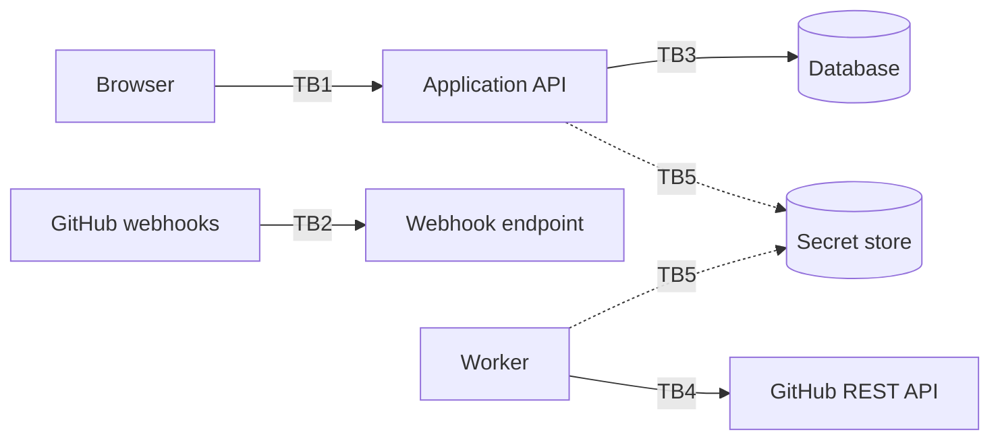

# DevFlow — Security Requirements and Threat Mitigations

| Field | Value |
|---|---|
| Status | Draft v0.1 |
| Source | `mvp.md` §9.1–9.3, §14, §15, §18.3, §18.5; requirement IDs from [prd.md](prd.md) |
| Implementation evidence | **None.** No repository was provided. Every control below is "Required (not implemented/unverified)". Existence of this document does not make the system secure. |
| Compliance | `mvp.md` states no compliance obligations (GDPR, SOC 2, etc.). None are asserted here. Whether pilot data triggers privacy-law obligations is **OPEN (OQ-20)**. |
| Related | [architecture.md](architecture.md) · [rules.md](rules.md) · [design.md](design.md) · [phases.md](phases.md) · [memory.md](memory.md) |

Control status column legend: **Required** = mandated by `mvp.md`; **Proposed** = added here, needs approval; every control is currently unverified.

## 1. Assets and sensitive data

| ID | Asset | Why it matters | Classification (PROPOSED) |
|---|---|---|---|
| AS-01 | GitHub App private key / app credentials | Can mint installation tokens for every customer installation | Critical secret |
| AS-02 | Installation and access tokens | Read access to private repository metadata | Critical secret |
| AS-03 | Webhook secret | Forging it lets an attacker inject events and corrupt metrics | Critical secret |
| AS-04 | Session/credential material for DevFlow users | Account takeover → access to workspace data | Critical |
| AS-05 | Repository metadata: PR titles, branch names, authors, reviewer identities, timestamps, URLs | Private repositories' PR titles/branches can reveal confidential work (`mvp.md` §20) | Confidential |
| AS-06 | Raw webhook payloads (FR-023) | May contain more fields than the product needs | Confidential; minimize (NFR-008) |
| AS-07 | Derived data: metrics, insights, task–PR links | Could be misused as individual performance evidence (RISK-09) | Confidential; integrity-critical |
| AS-08 | Audit records | Integrity needed for accountability (FR-120) | Integrity-critical |
| AS-09 | Workspace/user account data (display name, authentication identity) | Personal data | Personal |
| AS-10 | Database backups and logs | Copies of all of the above | Same as source data |

Not collected (REQ §15.3): repository source code, private message content, unrelated user data.

## 2. Trust boundaries and entry points

| ID | Boundary / entry point | Untrusted input |
|---|---|---|
| TB1 | Browser → Application API | All request data, identifiers in URLs, settings, notes, link edits |
| TB2 | GitHub → webhook endpoint | Entire body and headers until the signature is verified; afterwards payload *content* is still data from a third-party system |
| TB3 | API/worker → database | Query construction |
| TB4 | Worker → GitHub REST API | Response bodies, pagination, rate-limit signals |
| TB5 | Application → secret store | Secret retrieval at runtime |
| EP-01 | Sign-in / account endpoints | Credentials, redirect targets |
| EP-02 | GitHub authorization callback | `state`, installation identifiers, returned codes |
| EP-03 | Settings and link mutations | Free text (notes, reasons, task-key pattern) |
| EP-04 | Any API route taking a record identifier | Identifier tampering |

## 3. Threat model (appropriate to this product; STRIDE-style)

Likelihood/impact are qualitative judgments for prioritization (PROPOSED), not measurements.

| ID | Threat | Entry | Impact | Mitigating controls |
|---|---|---|---|---|
| T-01 | Cross-workspace data access by swapping an ID (IDOR) | EP-04, TB1 | Disclosure of another team's private repo metadata | SEC-01, SEC-02, SEC-03 |
| T-02 | Forged webhook injecting fake events | TB2 | Corrupted metrics, false alerts | SEC-10, SEC-11 |
| T-03 | Replay of a captured valid webhook | TB2 | Duplicated effects | SEC-12 (idempotency by delivery ID); signature alone does not stop replay |
| T-04 | GitHub token / private key / webhook secret leakage (browser, logs, repo, error output) | TB1, logs, source control | Read access to repositories' metadata, forgery | SEC-20–SEC-24 |
| T-05 | Over-broad GitHub permissions | Integration config | Larger breach impact | SEC-13 |
| T-06 | OAuth/installation callback tampering (CSRF, forged `state`, attaching an installation to the wrong workspace) | EP-02 | Attacker's installation connected to victim workspace or vice versa | SEC-14 |
| T-07 | Stored XSS through PR titles, branch names, notes, task keys rendered in the UI | TB1, TB2 | Session theft, malicious actions | SEC-30, SEC-31 |
| T-08 | Injection (SQL/NoSQL/command) via task-key patterns, filters, sort parameters | EP-03 | Data disclosure/corruption | SEC-32 |
| T-09 | Task-key pattern causing catastrophic regex backtracking | EP-03, matcher | Denial of service on worker | SEC-33 |
| T-10 | Resource exhaustion via webhook flood, huge payloads, huge backfills, unbounded retries | TB2, jobs | Outage, runaway cost, GitHub rate-limit exhaustion | SEC-40–SEC-43 |
| T-11 | Privilege misuse: ordinary member disconnecting integrations, deleting data, editing thresholds | TB1 | Data loss, hidden alert suppression | SEC-04, SEC-05 |
| T-12 | Tampering with or deleting audit records | DB, API | Loss of accountability | SEC-06 |
| T-13 | Account takeover (weak sign-in, session fixation, no logout) | EP-01 | Full workspace access | SEC-07, SEC-08, SEC-09 |
| T-14 | Information disclosure through error messages and account enumeration | EP-01, TB1 | Reconnaissance | SEC-50, SEC-51 |
| T-15 | Compromised or malicious dependency (supply chain) | Build | Arbitrary code execution | SEC-60–SEC-63 |
| T-16 | Revoked access still used / data kept after disconnect | Integration lifecycle | Unauthorized access, privacy breach | SEC-15, SEC-70 |
| T-17 | Metrics misused to evaluate individuals | Product/UX | Harm to people; trust loss | BR-05, RL-46, [design.md](design.md) DG-06 (product control, not technical) |
| T-18 | Raw payload retention exposes more than needed | Storage | Unnecessary exposure after breach | SEC-71, SEC-72 |
| T-19 | Forged or stale link edits via CSRF | TB1 | Unauthorized changes to link data | SEC-16 |
| T-20 | Reconciliation/recompute bugs overwrite valid data after upstream failure | Worker | Silent data loss | RL-16 (engineering control), SEC-73 |

## 4. Authentication and authorization (FR-001–FR-004, NFR-001)

| ID | Control | Status |
|---|---|---|
| SEC-01 | Every workspace-owned record carries workspace scope and every read/write enforces it **server-side** (no reliance on client route guards). | Required (REQ §9.1, §15.2) |
| SEC-02 | The workspace for a request is derived from the authenticated session/membership, not from a client-supplied parameter alone. | Proposed (AD-05) |
| SEC-03 | Automated tests attempt cross-workspace reads and writes by ID substitution on every API route; they must fail closed with the same response as a nonexistent record. | Required (REQ §9.1 acceptance) |
| SEC-04 | A central authorization function checks (user, workspace, action); integration management, disconnect, destructive actions, data deletion, threshold changes and admin reconcile require an authorized role. | Required where "authorized roles" are stated (REQ §9.1 SHOULD roles; role model OPEN, OQ-12) |
| SEC-05 | Default-deny: new endpoints are inaccessible until a policy is declared. | Proposed |
| SEC-06 | Audit records are append-only for application code (no update/delete path in the API). | Proposed (supports FR-120) |
| SEC-07 | Sign-in mechanism chosen under OQ-11 must support sign-out that invalidates the server-side session/token. | Required (FR-001); mechanism OPEN |
| SEC-08 | Session identifiers are regenerated on sign-in; sessions have an expiry (duration OPEN). | Proposed |
| SEC-09 | If passwords are used, they are stored only as salted adaptive hashes and never logged; strength and lockout rules defined at selection time. If an external identity provider is used, token validation follows its documentation. | Proposed; conditional on OQ-11 |
| SEC-16 | State-changing requests are protected against cross-site request forgery appropriate to the session transport. | Proposed |
| SEC-50 | Authentication failure messages do not reveal whether an account exists. | Proposed |

## 5. GitHub authorization and integration security (FR-010–FR-019, NFR-007)

| ID | Control | Status |
|---|---|---|
| SEC-13 | Request only the GitHub App permissions required by MVP features (read access to pull request and review metadata; exact names verified against current GitHub docs at implementation time). No code/contents access (NFR-008). The final permission list is also what [design.md](design.md) S-02 shows users (D-11). | Required (REQ §15.1); list OPEN |
| SEC-14 | The authorization/installation callback validates a single-use `state` bound to the initiating user and workspace; an installation is attached only to that workspace. | Proposed (addresses T-06) |
| SEC-15 | On revoked/expired access: stop API calls for that installation, set `Needs attention`, preserve stored secrets' protection; on disconnect: stop all calls, revoke where possible. | Required (REQ §9.2, §14, §18.5) |
| SEC-17 | Missing-permission errors are explained to the user without exposing credentials (FR-019). | Required (SHOULD in REQ) |
| SEC-18 | The browser never receives installation tokens, access tokens, webhook secrets or app keys (FR-016). | Required |

## 6. Webhook handling, input validation, output encoding

| ID | Control | Status |
|---|---|---|
| SEC-10 | Verify the webhook signature over the **raw request body** using GitHub's documented method (HMAC with the webhook secret; header names and algorithm to be confirmed against current docs — ASSUMPTION, GitHub docs not re-fetched in this task) with constant-time comparison; reject missing/invalid signatures before parsing or storing the payload. | Required (FR-020) |
| SEC-11 | Unverified requests are rejected with a generic response and a log entry containing no payload. | Proposed |
| SEC-12 | Persist the delivery ID and dedupe on it (plus the derived `deduplication_key`) so replays have no effect. | Required (FR-021, FR-026, NFR-002) |
| SEC-30 | Treat every GitHub-sourced string (titles, branch names, logins, URLs) and every user-entered string as untrusted; encode on output in the context where it is rendered (HTML, attribute, URL). No raw HTML rendering of such content. | Proposed |
| SEC-31 | Links to GitHub items are built from stable IDs/validated URLs with an allowlisted scheme and host pattern; external links use `rel="noopener noreferrer"`. | Proposed |
| SEC-32 | Parameterized queries only; sort/filter parameters validated against allowlists. | Proposed |
| SEC-33 | Task-key patterns are restricted to a safe, bounded syntax (or matched with a linear-time engine) with length limits and execution time limits. | Proposed |
| SEC-34 | Runtime schema validation for webhook payloads, GitHub API responses, API requests and settings (RL-11); unknown or invalid payloads are quarantined as failed with the delivery ID, not silently dropped. | Proposed |
| SEC-35 | A Content-Security-Policy that forbids inline script and third-party script origins, plus standard anti-framing and content-type protections. | Proposed |

## 7. Secrets, tokens, and environment variable management (FR-016, NFR-005)

| ID | Control | Status |
|---|---|---|
| SEC-20 | Secrets (app private key, webhook secret, DB credentials, session secret, token encryption key) are loaded at runtime from a server-side secret store or encrypted configuration; never in the repository, client bundle, API responses or logs. | Required (REQ §15.1) |
| SEC-21 | Installation tokens are requested on demand, kept in memory or encrypted at rest, and never persisted in plaintext; any stored token or key is encrypted at rest. | Proposed (REQ says "stored securely") |
| SEC-22 | Separate secrets per environment; test installations use separate App credentials from production. | Proposed |
| SEC-23 | Secret scanning on commits and in CI once tooling exists (RL-49); a leaked secret is rotated, not just removed. | Proposed |
| SEC-24 | Rotation procedure for the webhook secret and app private key is documented before pilot. | Proposed |
| SEC-25 | The example env file lists variable names with empty values only. | Proposed |

## 8. Data protection, privacy, and retention (NFR-008, NFR-012, FR-114)

| ID | Control | Status |
|---|---|---|
| SEC-70 | A documented retention and deletion policy exists **before** onboarding real pilot users, covering raw payloads, normalized events, audit records, derived results, and behaviour on disconnect and on member departure. | Required (REQ §15.3, §9.11); values OPEN (OQ-10) |
| SEC-71 | Store only the GitHub metadata fields the product uses; raw payload storage keeps the minimum needed for replay/debug and is subject to the retention policy. | Required (NFR-008) / Proposed implementation |
| SEC-72 | Raw payloads are access-restricted (not exposed through normal APIs) and encrypted at rest. | Proposed |
| SEC-73 | Deletion removes data from primary storage and defines behaviour for backups (documented expiry). | Proposed |
| SEC-74 | The product explains in-app which metadata it collects and why. | Required (REQ §15.3 "be clear"); wording OPEN |
| SEC-75 | Encryption in transit: HTTPS for all deployed endpoints; no plaintext HTTP for webhooks or API. | Required (REQ §15.1) |
| SEC-76 | Database and backup encryption at rest per hosting platform capability. | Proposed |
| SEC-77 | When a workspace member leaves, access is revoked per a documented policy; data-ownership policy OPEN. | Required (REQ §14 edge case); policy OPEN |

Human-impact controls (REQ §15.4): no individual rankings or productivity scores in any API or UI; alert wording constraints (FR-084). These are product and engineering controls enforced by RL-46 and DAC-07, not technical access controls.

## 9. Logging and error disclosure

| ID | Control | Status |
|---|---|---|
| SEC-51 | User-facing errors contain a plain-language message and an error code; no stack traces, SQL, internal paths, tokens or payload fragments. | Proposed (REQ §15.1 "never log"; RL-14) |
| SEC-52 | Logs are structured and exclude tokens, keys, secrets, cookies and raw payload bodies; log fields are allowlisted. | Required (REQ §15.1) |
| SEC-53 | Security-relevant events are logged with workspace and actor IDs: failed signature verifications, authorization denials, integration connect/disconnect/revoke, role changes, admin replay/reconcile. | Proposed |
| SEC-54 | Log access is restricted to operators; retention follows the retention policy. | Proposed |

## 10. Dependency and supply-chain risks (T-15)

| ID | Control | Status |
|---|---|---|
| SEC-60 | Lockfile committed; reproducible installs. | Proposed (RL-26) |
| SEC-61 | Automated vulnerability scanning of dependencies in CI and on a schedule once CI exists; critical findings block release. | Proposed (RL-27) |
| SEC-62 | Each dependency addition is justified in review (RL-25); prefer well-maintained packages; review install scripts for new packages. | Proposed |
| SEC-63 | Build artifacts are produced from CI from a clean checkout; production deploys do not use local developer machines. | Proposed |
| SEC-64 | No runtime loading of third-party scripts in the UI (RL-28); webhook and API clients use pinned, maintained libraries. | Proposed |

## 11. Abuse cases, rate limiting, resource exhaustion (T-10)

| ID | Control | Status |
|---|---|---|
| SEC-40 | Maximum accepted webhook body size, set from observed GitHub payload sizes at implementation time (value OPEN); oversize requests are rejected before reading fully. | Proposed |
| SEC-41 | Rate limit on the webhook endpoint and on unauthenticated routes per source; never block verified GitHub deliveries that are within normal volume without alerting an operator. | Proposed |
| SEC-42 | Per-account rate limits on sign-in and on expensive read endpoints; per-workspace caps on concurrent sync/recompute jobs. | Proposed |
| SEC-43 | Bounded concurrency and bounded exponential backoff with a maximum retry count for GitHub API calls and job retries; respect GitHub rate-limit signals; resume from checkpoints (FR-014, FR-015, FR-028). | Required (REQ §9.2, §9.3) |
| SEC-44 | Backfill size is bounded by the configured history depth (OQ-07). | Proposed |
| SEC-45 | Metric recomputation is scoped to affected records, not a global recalculation on every event. | Proposed (architecture §13) |

## 12. Security testing and verification criteria

| ID | Verification | Maps to |
|---|---|---|
| SV-01 | Cross-workspace access tests for every route (read, write, delete) | SEC-01–SEC-03, NFR-001, REQ §18.5 |
| SV-02 | Webhook signature tests: valid, invalid, missing, modified body, wrong secret | SEC-10, SEC-11 |
| SV-03 | Duplicate-delivery and replay tests show no duplicate events, metrics, insights or audit records | SEC-12, AC-01 |
| SV-04 | Grep/scan of build output, API responses (representative set) and logs for token, key and secret patterns finds none | SEC-18, SEC-20, SEC-52 |
| SV-05 | Callback `state` tests: missing, reused, mismatched user/workspace | SEC-14 |
| SV-06 | XSS tests with hostile PR titles, branch names, notes and task keys | SEC-30, SEC-31, SEC-35 |
| SV-07 | Authorization tests per action for each role (once roles are decided) | SEC-04, SEC-05 |
| SV-08 | Revocation test: after disconnect or revocation, no further GitHub API calls are made for that installation | SEC-15, AC-07 |
| SV-09 | Rate-limit and retry tests: backoff, cap, resume from checkpoint | SEC-43 |
| SV-10 | Pathological task-key pattern test (long input, backtracking pattern) completes within the time limit or is rejected | SEC-33 |
| SV-11 | Dependency scan has no unresolved critical findings at release | SEC-61 |
| SV-12 | Error-response tests show no stack traces, SQL or secrets | SEC-51 |
| SV-13 | Deletion test: after deletion request, data covered by the policy is gone from primary storage | SEC-70, SEC-73 |
| SV-14 | A security review is performed before pilot (REQ §19 Phase 5); findings are tracked to closure | phases.md PH-5 |

Required before pilot (REQ §21): workspace isolation tested; secrets not exposed to clients or logs; webhook signature validation tested; revocation/disconnection handled; rate limits and retry failures handled; retention/deletion documented.

## 13. Prioritized risks and mitigations

Priority: P0 = must be closed before any real data; P1 = before pilot; P2 = before broader use. Priorities are PROPOSED.

| ID | Risk | Priority | Mitigations | Verification |
|---|---|---|---|---|
| SR-01 | Cross-workspace data exposure (T-01) | P0 | SEC-01–SEC-03 | SV-01 |
| SR-02 | Secret/token leakage (T-04) | P0 | SEC-18, SEC-20–SEC-24, SEC-52 | SV-04 |
| SR-03 | Forged or replayed webhooks (T-02, T-03) | P0 | SEC-10–SEC-12 | SV-02, SV-03 |
| SR-04 | Installation attached to wrong workspace / callback tampering (T-06) | P0 | SEC-14 | SV-05 |
| SR-05 | Stored XSS from GitHub-sourced strings (T-07) | P1 | SEC-30, SEC-31, SEC-35 | SV-06 |
| SR-06 | Retention/deletion undefined before real data (T-16, T-18) | P1 | SEC-70–SEC-73 (blocked by OQ-10) | SV-13 |
| SR-07 | Over-broad GitHub permissions (T-05) | P1 | SEC-13 | Permission review at App registration |
| SR-08 | Role gaps allow destructive actions (T-11) | P1 | SEC-04, SEC-05 (blocked by OQ-12) | SV-07 |
| SR-09 | Resource exhaustion and rate-limit exhaustion (T-10) | P1 | SEC-40–SEC-45 | SV-09 |
| SR-10 | Account takeover / weak sign-in (T-13) | P1 | SEC-07–SEC-09, SEC-16, SEC-50 (blocked by OQ-11) | Per mechanism |
| SR-11 | Supply-chain compromise (T-15) | P1 | SEC-60–SEC-64 | SV-11 |
| SR-12 | Injection and ReDoS via task-key patterns (T-08, T-09) | P1 | SEC-32, SEC-33 | SV-10 |
| SR-13 | Audit tampering (T-12) | P2 | SEC-06 | Code review + test |
| SR-14 | Metrics misused against individuals (T-17) | P1 | BR-05, RL-46, DG-06, FR-084 | DAC-07; pilot review (REQ §18.6) |
| SR-15 | Data loss from reconciliation after upstream error (T-20) | P1 | RL-16, SEC-73 | Edge-case matrix (AC-08) |
| SR-16 | Unknown privacy-law applicability (OQ-20) | P1 | Decision outside engineering; record the outcome in memory.md | Decision recorded |

## 14. Open security questions

| ID | Question | Related |
|---|---|---|
| OQ-11 | Authentication mechanism and session transport | SEC-07–SEC-09, SEC-16 |
| OQ-10 | Retention periods and deletion semantics | SEC-70–SEC-73 |
| OQ-12 | Role model | SEC-04 |
| OQ-20 | Privacy-law applicability for pilot data | SR-16 |
| SQ-01 | Final GitHub App permission set and webhook event subscriptions | SEC-13 |
| SQ-02 | Operator alerting channel for security events | SEC-53 |
| SQ-03 | Session lifetime and idle timeout values | SEC-08 |
